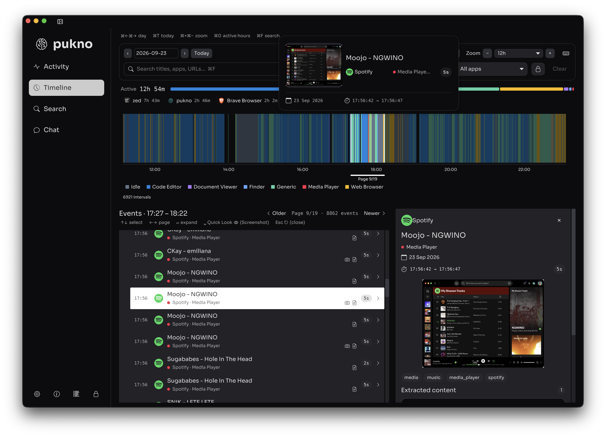
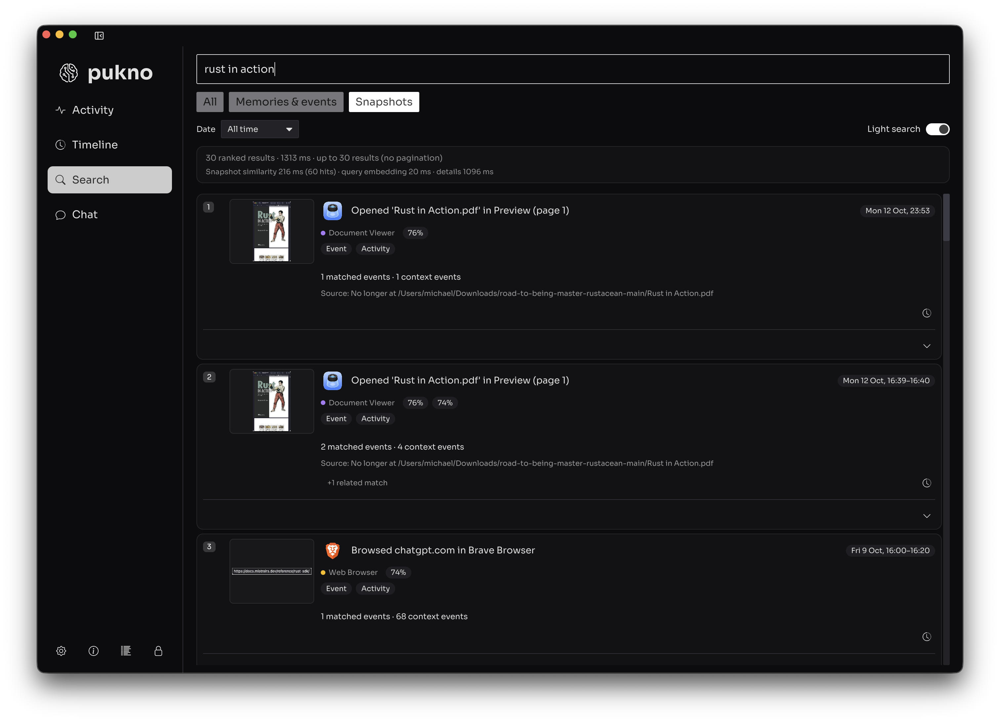
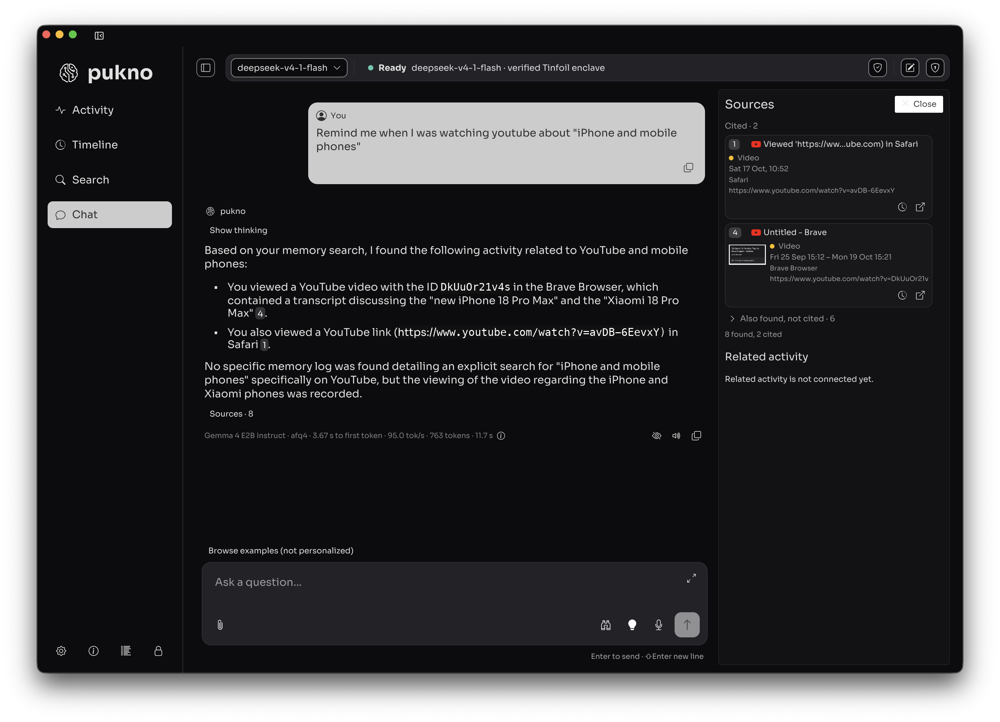

# PUKNO — Personalized Universal Knowledge

**Your memories today. Your intelligence tomorrow.**

PUKNO is a private, local-first AI memory app being built for Mac. It turns your digital activity into personal context you can explore, search, and ask questions about—helping you reconnect with what you’ve seen, learned, and worked on.

Instead of starting every conversation from scratch, give your AI the context to understand your past and help you make more of what comes next.

[Explore PUKNO](https://pukno.ai) · [Get Early Access](https://pukno.ai/#notify) · [Ελληνικά](https://pukno.ai/index-el.html)

## Remember. Find. Ask.

### Remember — return to the moments that matter

Explore your activity in a private timeline, with apps, sessions, timestamps, and captured screen previews. Revisit a moment with the context behind it, rather than trying to remember exactly where or when it happened.



### Find — rediscover what you only partly remember

Search captured screens by topic and find relevant moments without needing an exact filename or date. Explore ranked results and take a closer look at the original context.



### Ask — connect memories with understanding

Ask about your activity, ask questions about image content, or explore the context of a YouTube video. PUKNO brings relevant memories and source cards into the conversation to help you connect what you’ve seen and learned.



Visit [PUKNO today](https://pukno.ai/#product) for more screenshots, interactive galleries, and a video walkthrough.

## Private by design

- **Local-first memory:** activity and personal context are processed on your Mac by default.
- **Local AI:** core activity capture, history, and local recall can work offline without sending your personal context to a remote AI service.
- **Optional Private Compute:** more demanding requests can use larger models in protected confidential-computing environments. Remote processing requires an internet connection, your explicit consent, and settings you control.

Local AI remains the default. Private Compute is an option, not a requirement for using your local memory.

## What’s available, and what’s next?

PUKNO is in early development, with the first releases focused on **Apple silicon Macs**. Join the early-access list for availability updates.

| Capability | Current status |
| --- | --- |
| Activity capture and timeline | Captures and organizes activity on your Mac. |
| PUKNO Memory | Integrated into search and chat, with captured moments, context, and source cards. |
| Local AI | Processes requests on your device by default. |
| Private Compute | Optional access to larger models with explicit consent. |
| Agent access to memory | Read-only retrieval of local memory and context; no data changes or actions. |
| PUKNO Sync | Planned cross-device memory with end-to-end encryption. Not available yet. |
| Agent actions | Multi-agent coordination and task execution are planned. Not available yet. |
| Windows and Linux | Planned; macOS is the initial focus. |

Planned features describe the direction of the product, not capabilities available today.

## Get early access

Every day adds to your personal memory. Help shape what PUKNO becomes next.

**[Get Early Access →](https://pukno.ai/#notify)**

---

## About this repository

This repository contains the **PUKNO marketing website**, not the Mac application’s source code. It is a bilingual static site with English and Greek pages, light/dark themes, product galleries, and an embedded Tally signup form.

### Project structure

```text
pukno.ai/
├── assets/
│   ├── site.css          # Shared styles, themes, and responsive layouts
│   ├── site.js           # Tabs, accordions, theme switching, and site interactions
│   ├── gallery.js        # Product galleries, swipe navigation, and enlarged viewer
│   ├── theme-init.js     # Restores the saved theme before rendering
│   ├── screenshots/     # Product screenshots
│   ├── destinations/    # Supporting website imagery
│   ├── audio/
│   └── ...              # Logo assets
├── index.html            # English
├── index-el.html         # Greek
├── CNAME                 # Custom domain for GitHub Pages
└── README.md
```

### Preview locally

From the repository root, run:

```sh
python3 -m http.server 8000
```

Open [the English page](http://localhost:8000/index.html) or [the Greek page](http://localhost:8000/index-el.html). No package installation or build step is required.

### Editing content

- Edit English copy in `index.html` and Greek copy in `index-el.html`.
- Keep section IDs aligned so the language switch preserves the current section.
- Both pages share CSS and JavaScript. The `ui-text` JSON in each page supplies translated labels for shared site interactions; gallery captions and controls are in the HTML.
- Product galleries appear under Remember, Find, and Ask. Keep the screenshot order aligned between languages and provide translated captions and accessible labels.
- Clicking a category starts at its first image. Arrows and swipes continue across categories; the enlarged viewer supports keyboard navigation and full-size zoom.
- Screenshots and the video walkthrough retain their original language. The signup form is hosted by Tally; translating its contents requires configuring a Greek form and updating the Greek page’s `data-tally-src`.

### Deployment

Deploy both HTML files and the `assets/` directory together to GitHub Pages or another static host, preserving their relative paths. Keep `CNAME` when deploying to the existing custom domain.

JavaScript runs in the visitor’s browser; there is no server-side application or build pipeline required by this site. Tally handles signup submissions, and the video walkthrough is embedded from YouTube. These external services require an internet connection.
